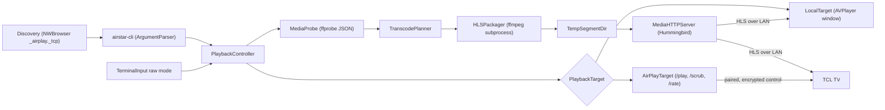

# AirPlay MKV streaming: implementation notes

`airstar-cli` is a macOS 14+ command-line tool, written in Swift. It plays MKV files in a native window and streams them to AirPlay TVs. The primary target is a TCL Google TV with an AirPlay 2 receiver. This document covers how each part is built, why it was built that way, and what we learned from testing on real receivers.

## Overview



Neither AVPlayer nor an AirPlay receiver can open MKV. Every playback, local or remote, therefore follows the same steps:

1. `ffprobe` describes the streams in the file.
2. `TranscodePlanner` decides, stream by stream, whether to copy it or transcode it.
3. `ffmpeg` writes an HLS playlist and segments into a temporary directory.
4. A small HTTP server serves that directory.
5. The local window, or the TV through AirPlay URL playback, pulls the stream from that server.

## Package layout

| Path | Role |
| --- | --- |
| `Sources/AirstarCore/Discovery` | Bonjour browsing, TXT record and feature-flag parsing, device selection |
| `Sources/AirstarCore/Media` | ffprobe model, transcode planner, HLS packager, playlist parser |
| `Sources/AirstarCore/Server` | Hummingbird HTTP server for the HLS output |
| `Sources/AirstarCore/AirPlay` | TLV8, SRP-6a, HAP pairing and session encryption, HTTP/RTSP framing, `AirPlayClient`, Keychain store |
| `Sources/AirstarCore/Playback` | `PlaybackTarget` protocol, local and AirPlay targets, state machine, seek planner, key decoder, controller |
| `Sources/airstar-cli` | Commands (`devices`, `info`, `play`, `cast`, `pair`), terminal raw mode, session runner |
| `Tests/AirstarCoreTests` | 97 Swift Testing tests, including ffmpeg integration tests and an in-process AirPlay 2 mock receiver |

`AirstarCore` contains no CLI code. A future SwiftUI app can link it directly, drive `PlaybackController`, and render `PlayerSnapshot` instead of the terminal status line.

## Technologies considered

| Decision | Chosen | Alternatives and why not |
| --- | --- | --- |
| Language | Swift 6 toolchain (Swift 5 language mode), SwiftPM | **Rust or Go**: no mature AirPlay sender library exists; both would need ffmpeg bindings and a hand-written AirPlay stack, and a native Mac GUI is much harder. Swift gives AVFoundation, VideoToolbox, Network.framework, CryptoKit and an easy SwiftUI path. Release-build performance is native (an SRP pairing handshake takes about 0.14 s). |
| AirPlay protocol | Own implementation (TLV8, SRP-6a, HAP pair-setup and pair-verify, ChaCha20-Poly1305 framing) | **SwiftATV** covers Apple TV remote control (MRP/Companion) and HAP pairing, but has no URL playback (`/play`), and its device model assumes Apple TVs. **pyatv** (Python) has `play_url` but would mean shipping a Python runtime. pyatv's protocol documentation was the main reference. |
| Streaming mode | AirPlay URL playback of HLS served by the Mac | **Screen-mirroring-style push** needs real-time re-encoding, has higher latency and CPU use, and is far more complex. URL playback lets the TV buffer, seek, and decode the original bitstream. |
| MKV handling | ffmpeg and ffprobe from Homebrew, run as subprocesses | **Linking libav\*** produces a single binary but has a heavy build and licensing surface. **Pure Apple frameworks** have no MKV demuxer. |
| Video transcoding | Copy H.264 and HEVC; otherwise `h264_videotoolbox` | Software x264 uses far more CPU. Always transcoding wastes quality and power. |
| HTTP server | Hummingbird 2 (`FileMiddleware`) | **A hand-rolled `NWListener` server** would mean writing Range, ETag and 404 handling ourselves. Hummingbird provides byte ranges and is built on SwiftNIO. |
| Big-integer math for SRP | attaswift/BigInt | **swift-srp** uses slightly different padding conventions from HomeKit, so we keep control of the exact formulas. |
| Local player | AVPlayer in an `AVPlayerView` window | **A custom VideoToolbox and Metal renderer** would be much more work for the same hardware decoding. |
| CLI parsing | swift-argument-parser | Standard choice, with completion and help for free. |

## Discovery (`AirPlayBrowser`, `AirPlayDevice`, `FeatureFlags`)

`NWBrowser` browses `_airplay._tcp` with TXT records. The `features` value (`0xLOW,0xHIGH`) becomes a 64-bit `OptionSet`:

```swift
public init?(txtValue: String) {
    let parts = txtValue.split(separator: ",").map { $0.trimmingCharacters(in: .whitespaces) }
    guard (1...2).contains(parts.count) else { return nil }
    ...
    var value = low & 0xFFFF_FFFF
    if parts.count == 2 { value |= (high & 0xFFFF_FFFF) << 32 }
    self.init(rawValue: value)
}
```

Device capabilities are derived from those flags:

- **Video:** bits 0 (Video) and 4 (VideoHTTPLiveStreams) mean the receiver accepts HLS URL playback.
- **AirPlay 2:** bit 38 (CoreUtils pairing) or bit 40 (unified media control) marks an AirPlay 2 receiver, the same rule pyatv uses.
- **Pairing mode:** for AirPlay 2 receivers, bit 48 (transient pairing) decides between transient pairing and PIN pairing.

Lessons from the real network:

- **Connect over IPv4 through Bonjour.** Resolution sometimes yields a link-local IPv6 address. Stripping its `%en0` scope for display made it unreachable, and such an address can't be put in a media URL anyway. Connections therefore always go through the Bonjour service endpoint, restricted to IPv4 (`AirPlayDevice.tcpParameters()`). The Mac's local address on that connection becomes the host in the HLS URL.
- **One receiver, many results.** The same receiver appears once per network interface, so results are de-duplicated by name.

## Media pipeline

### Probe (`MediaProbe`, `MediaInfo`)

The probe runs `ffprobe -print_format json -show_format -show_streams`. Video streams marked as `attached_pic` (cover art) are skipped. Audio tracks get 1-based track numbers, which `--audio-track` uses. `--audio-lang` matches language codes exactly or by prefix (`en` matches `eng`).

### Planner (`TranscodePlanner`)

The planner is a pure function, which makes it easy to unit test:

| Input | Action |
| --- | --- |
| H.264, 8-bit 4:2:0 | copy |
| HEVC (8-bit or 10-bit) on a receiver that supports HEVC | copy, tagged `hvc1`, always fMP4 segments |
| Anything else (VP9, AV1, 10-bit H.264, MPEG-2, and so on) | `h264_videotoolbox`; bitrate 2.5, 5, 8 or 20 Mbit/s by height; GOP of 4 s |
| AAC audio | copy |
| Other audio (AC3, E-AC3, DTS, TrueHD, Opus, FLAC) | AAC, at most 2 channels, 192 kbit/s |

### Segment container (an important finding)

The first spike sent fMP4 HLS to a real AirPlay 1 receiver (a Nebula projector running an Android-based AirPlay implementation). It fetched `init.mp4` and the first segment, then stalled with the position stuck at 0. The same stream as MPEG-TS played immediately, buffered ahead, and reported its position correctly.

Non-Apple receivers, which describes most AirPlay TVs including TCL, Samsung and LG, are built on Android or other non-Apple players. So the planner now uses:

- **MPEG-TS** for H.264 on every AirPlay target (`ReceiverCapabilities.airPlay`, overridable with `--segment-format`).
- **fMP4** for HEVC, which HLS requires, and for the local AVPlayer.

### Packager (`HLSPackager`)

ffmpeg writes an EVENT playlist (one that grows while it's written) into `gen-N/` under a temp root:

```text
ffmpeg -hide_banner -nostdin -loglevel error -y [-ss START] -i input.mkv \
  -map 0:<video> -map 0:<audio> -c:v copy|h264_videotoolbox ... -c:a copy|aac -ac 2 -b:a 192k \
  -sn -dn -f hls -hls_time 4 -hls_list_size 0 -hls_playlist_type event \
  -hls_flags independent_segments+temp_file -hls_segment_type mpegts|fmp4 ... gen-N/index.m3u8
```

- **Readiness:** `start()` returns once the playlist lists at least two segments, or is complete.
- **Generations:** seeking past what has been transcoded, or switching audio track, starts a new generation (`gen-2`, `gen-3`, ...) with `-ss`. The controller adds the generation's start offset to every position the target reports.
- **Progress:** `progress()` sums the playlist's `#EXTINF` durations and watches for `#EXT-X-ENDLIST`.
- **Stopping ffmpeg:** `Process.waitUntilExit()` deadlocked the test runner, because it needs a run loop that cooperative-pool threads don't have. Stopping now sends SIGTERM, polls `isRunning`, and falls back to SIGKILL after 3 s.

### HTTP server (`MediaHTTPServer`)

Hummingbird's `FileMiddleware` serves the temp root with Range and ETag support. A small middleware sets HLS content types (`application/vnd.apple.mpegurl`, `video/mp2t`, `video/iso.segment`) and `Cache-Control: no-cache` on the growing playlist.

- **Binding:** the server listens on `127.0.0.1` for `play` and on `0.0.0.0` for `cast`.
- **Port:** port 0 picks a free port, which is read back from `onServerRunning`. `--port` pins it for firewall rules.

## AirPlay protocol (`Sources/AirstarCore/AirPlay`)

### AirPlay 1 (no pairing)

Plain HTTP on the control connection, which must stay open for the whole session:

| Request | Purpose |
| --- | --- |
| `POST /play` | binary plist `{Content-Location, Start-Position}`; falls back to `text/parameters` if the receiver answers 400 or 415 |
| `POST /rate?value=0` and `POST /rate?value=1` | pause and resume |
| `POST /scrub?position=S` | seek |
| `GET /playback-info` | status (binary plist with `duration`, `position`, `rate`, `readyToPlay`, `error`) |
| `POST /stop` | end playback |

### AirPlay 2 (TCL Google TV and other modern TVs)

1. **Pairing, done once with `airstar-cli pair <tv>`.**
   - The client sends `POST /pair-pin-start`, and the TV shows a 4-digit PIN.
   - HomeKit pair-setup M1–M6 follows over `POST /pair-setup` (`X-Apple-HKP: 3`, TLV8 bodies).
   - SRP-6a uses the RFC 5054 3072-bit group with g = 5 and SHA-512, under the username `Pair-Setup`.
   - M5 and M6 exchange Ed25519 long-term keys, encrypted with ChaCha20-Poly1305 using a key from `HKDF-SHA512(K, "Pair-Setup-Encrypt-Salt", "Pair-Setup-Encrypt-Info")`.
   - Credentials (our Ed25519 private key and ID, the TV's ID and public key) are saved in the login Keychain under service `com.airstar.cli.pairing`, keyed by the TV's `deviceid`.
2. **Verification on every connection.** Pair-verify M1–M4 over `POST /pair-verify` runs an X25519 key exchange, and each side checks the other's Ed25519 signature. The client then derives `Control-Write-Encryption-Key` and `Control-Read-Encryption-Key` from `Control-Salt`, and everything after that is HAP-framed:

   ```swift
   // [2-byte LE length][ciphertext][16-byte tag], length is the AAD, nonce = 4 zero bytes + LE counter
   let sealed = try HAPCrypto.seal(Data(chunk), key: writeKey, nonce: HAPCrypto.counterNonce(writeCounter), aad: lengthBytes)
   ```

3. **Transient pairing.** Receivers that advertise bit 48 and have no stored credentials get pair-setup with flag `0x10` and PIN `3939`. It stops after M4, and the SRP session key becomes the shared secret.
4. **Session setup.**
   - `SETUP rtsp://<mac-ip>/<id> RTSP/1.0` creates a session for remote control only (`isRemoteControlOnly`, `timingProtocol: None`).
   - If the TV returns an `eventPort`, the client connects to it and answers the TV's requests with 200, encrypted with `Events-Salt` keys.
   - `POST /feedback` keeps the session alive every 2 s.
5. **Playback.** `POST /play` carries the AirPlay 2 body (`Content-Location`, `Start-Position-Seconds`, `uuid`, `streamType: 1`, `mediaType: file`, ...). It's retried on HTTP 500, which some receivers return while tearing down a previous item. `/rate`, `/scrub` and `/playback-info` work as in AirPlay 1. Volume uses `SET_PARAMETER volume: <dB>` (from -30 to 0 dB, -144 for mute), falling back to `/volume`.

`AirPlayConnection` is an actor that sends one request at a time. Network.framework reads don't respond to task cancellation, so each request runs a timer that cancels the connection if the receiver stalls. With `AIRSTAR_DEBUG=1`, every request and status code is logged to stderr.

### Verification

- **Real receivers.**
  - On the AirPlay 1 Nebula projector on the development network, discovery, `/play`, `/rate`, `/scrub`, `/playback-info`, volume and `/stop` all work.
  - This Mac's own AirPlay 2 receiver refused transient pairing with HTTP 403. That's the macOS default "Allow AirPlay for: Current User" setting, and the CLI reports it as "requires pairing".
- **Mock receiver.**
  - `MockAirPlayReceiver` and `MockHAPAccessory` implement the receiver side over real TCP: SRP verifier, M2/M4/M6, pair-verify, HAP framing and the `/play` routes.
  - The tests cover PIN pair-setup followed by pair-verify, transient pairing, a wrong PIN, an impostor accessory failing pair-verify, and checks that every request after pairing is encrypted.
- **Test vectors.** SRP is checked against the RFC 5054 Appendix B vectors.

## Playback control

- **`PlaybackTarget`.** A protocol implemented by `LocalTarget` (an `@MainActor` class with `AVPlayer` and `AVPlayerView` in an `NSWindow`) and `AirPlayTarget` (wrapping `AirPlayClient`).
- **`PlaybackState`.** A small, pure state machine: idle, preparing, playing, paused, seeking, ended, failed.
- **`SeekPlanner`.** Seeks in place when the target lies inside the transcoded range, minus a two-segment safety margin while ffmpeg is still writing. Otherwise it restarts ffmpeg at the target.
- **Seek fallback (a finding from the real receiver).**
  - The Nebula acknowledged `/scrub` with HTTP 200 but kept playing from the old position. It had first received the playlist while it was still growing, treated the stream as live, and never allowed seeking.
  - The controller therefore checks every in-place seek about 1.5 s later. If the position is more than 5 s from the target, it restarts the stream at the target, and every later seek in that session restarts directly.
  - A related detail: sending `/rate?value=1` straight after `/scrub` undid the seek on that receiver, so seeks never send a rate change.
- **Ending playback.** End of media is detected when packaging is complete and the target has stopped near the end of the stream, or when an AirPlay receiver goes idle after playing.

### Terminal UI

- **Keys.** `TerminalInput` turns off canonical mode and echo but keeps `ISIG`, so Ctrl-C still raises SIGINT. `KeyDecoder` maps bytes to commands and buffers arrow-key escape sequences that arrive split across reads:

  | Key | Command |
  | --- | --- |
  | space | pause / resume |
  | ← → | seek 10 s |
  | ↑ ↓ | seek 60 s |
  | `+` `-` | volume |
  | `a` | cycle audio track |
  | `q` | quit |

- **Session runner.** `SessionRunner` redraws a one-line status every 0.5 s. SIGINT, SIGTERM, SIGHUP, `q` and closing the window all go through one `finish()`, which stops the target (sending `/stop`), stops ffmpeg, shuts down the server, deletes the temp directory and restores the terminal. Without a TTY (piped output), the session ends when the media ends.
- **AppKit integration.** Calling `NSApplication.run()` from inside the async command blocked the main dispatch queue, starving the main actor and the signal handlers, so `play` hung. It's now started with `RunLoop.main.perform { NSApplication.shared.run() }` while the async task stays suspended.

## Testing

`swift test` runs 97 tests in 21 suites (about 55 s in debug; the 3072-bit SRP math in the pairing tests dominates).

| Area | Tests |
| --- | --- |
| Discovery | feature-flag parsing from real TXT records, version and pairing-mode rules, device selection, IPv6 scope stripping |
| Media | ffprobe fixtures (H.264 + AC3/AAC, HEVC 10-bit + DTS, VP9 + Opus), audio selection, every planner branch, ffmpeg argument building |
| HLS (integration, needs ffmpeg) | generate MKVs with `lavfi`, package, serve over HTTP (200, 206 Range, 404, content types), restart at an offset with another audio track, VideoToolbox transcoding, ffmpeg failure reporting |
| AirPlay protocol | TLV8 fragmentation, RFC 5054 SRP vectors, HAP framing (split reads, tampering), PIN, transient and impostor pairing flows, HTTP/RTSP parser, request bodies, playback-info parsing |
| AirPlay client (TCP mock) | AirPlay 1 plain HTTP, AirPlay 2 transient with encryption, PIN pair then verify, wrong PIN, rejected `/play` with text fallback |
| Playback | key decoding, state machine, seek planner, status formatting, controller with a fake target (start, pause, seek, volume, audio cycling, end detection, failure, ignored-seek fallback) |

### Findings from the TCL 55T7 (Google TV, AirPlay SDK 3.6, AirTunes 377.40)

- **TXT record.** `features=0x7F8AD0,0x38BCF46` sets bit 4 (VideoHTTPLiveStreams) but not bit 0 (legacy Video). The video check originally required both bits and rejected the TV ("does not advertise AirPlay HLS video playback"). It now accepts either bit.
- **What works.** Transient pairing (SRP and HAP encryption) succeeds against the real TV, an encrypted `GET /info` returns the receiver's capabilities, and an encrypted RTSP `SETUP` returns an `eventPort`.
- **What doesn't.** Every legacy URL-playback route returns 404: `/play` (AirPlay 1 or 2 body, HTTP or RTSP, any User-Agent, with or without `SETUP` first), `/playback-info` and `/server-info`. Its `/info` reports `operatingSystem = Android`, `webEngineName = "Apple App Engine"`, `hlsJSVersion` and `supportsAirPlayVideoWithSharePlay = 1`. So the TV plays AirPlay video, but only through Apple's newer AirPlay 2 video protocol for SDK TVs, which isn't publicly documented.
- **Error message.** `cast` now reports this case as `urlPlaybackUnsupported` with an explanation, instead of a bare HTTP 404.
- **Google Cast.** The TV also advertises Google Cast (`_googlecast._tcp`), so `cast` now streams to it that way. See [google-cast-implementation.md](google-cast-implementation.md).

### Manual test on the TCL TV

1. Run `airstar-cli devices --verbose`. The TV should show as AirPlay 2 with `HLS video`. Note the pairing mode.
2. Run `airstar-cli pair "<TV name>"` and type the PIN the TV shows. If you get HTTP 403 or 470, set the TV's AirPlay setting to allow new devices or "Require code: first time only".
3. Run `airstar-cli cast movie.mkv -d "<TV name>"`, then check pause, ←/→, ↑/↓, `+`/`-`, `a` and `q`. Confirm that `q` stops playback on the TV.
4. If the TV shows a black screen with HEVC files, use `--force-h264`. If H.264 stalls, try `--segment-format fmp4`.
5. Rerun with `AIRSTAR_DEBUG=1` to capture the protocol exchange if anything is rejected.

## Known limitations

- Subtitles, HDR metadata and surround passthrough are out of scope for v1 (audio is downmixed to stereo AAC).
- AirPlay receivers protected by a password (`pw=1`) aren't supported.
- When video is copied, `-ss` starts at the previous keyframe, so positions after a restart can be off by up to one GOP.
- The macOS firewall may ask once to allow `airstar-cli` to accept incoming connections. The TV must be able to reach the media server.
