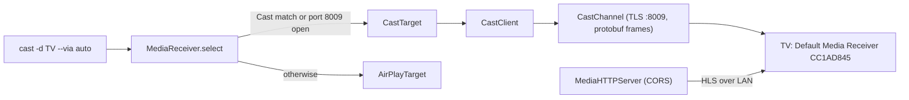

# Google Cast streaming: implementation notes

`airstar-cli cast` can stream to Google Cast receivers as well as AirPlay ones. This was added because the target TV, a TCL 55T7 running Google TV, pairs over AirPlay 2 but has no AirPlay URL-playback endpoint: every `/play` variant returns 404 (see [airplay-mkv-streaming-implementation.md](airplay-mkv-streaming-implementation.md)). The same TV has Chromecast built in, and Cast's media protocol is publicly documented.

## How it fits in



Probing, transcode planning, ffmpeg packaging, the HTTP server, `PlaybackController` (including seek verification and fallback) and the keyboard UI are all unchanged. Google Cast is one more `PlaybackTarget`.

## Protocol (CastV2)

| Layer | Implementation |
| --- | --- |
| Transport | TLS to port 8009 (`CastChannel`). Cast devices use self-signed certificates, so the verify block accepts any certificate; device authentication (`deviceauth`) is out of scope. IPv4 only, like AirPlay. |
| Framing | 4-byte big-endian length, then a protobuf `CastMessage`. The message is encoded by hand in `CastMessage.swift` (seven fields, varints and length-delimited fields, unknown fields skipped), so no SwiftProtobuf dependency is needed. |
| Payloads | JSON strings in `payload_utf8` |
| Virtual connections | `CONNECT` to `receiver-0` (the platform), then to the app's `transportId` once the app is running |
| Heartbeat | The channel replies `PONG` to the receiver's `PING` and sends its own `PING` every 5 s |
| Request correlation | Each request gets an incrementing `requestId`. The reply with the same id resumes the waiting continuation; anything else, such as a `MEDIA_STATUS` broadcast, goes to an unsolicited handler. |

The session flow in `CastClient`:

1. `LAUNCH {appId: "CC1AD845"}` starts the Default Media Receiver (or reuses it if it's already running) and returns `RECEIVER_STATUS` with the app's `transportId` and `sessionId`.
2. `CONNECT` to the `transportId`.
3. `LOAD` on `urn:x-cast:com.google.cast.media`:

   ```swift
   "media": [
       "contentId": url.absoluteString,
       "contentType": "application/x-mpegURL",
       "streamType": "BUFFERED",
       "hlsSegmentFormat": segmentFormat == .fmp4 ? "fmp4" : "ts",
       "hlsVideoSegmentFormat": segmentFormat == .fmp4 ? "fmp4" : "mpeg2_ts",
       "metadata": ["type": 0, "metadataType": 0, "title": title],
   ]
   ```

   The reply's `MEDIA_STATUS` carries the `mediaSessionId` that later commands need.
4. Control commands are `PLAY`, `PAUSE`, `SEEK {currentTime}` and `GET_STATUS`, each tagged with the `mediaSessionId`. Volume is `SET_VOLUME {volume: {level}}` on the platform receiver.
5. On quit, `STOP {sessionId}` closes the receiver app on the TV and the TLS connection is closed.

Replies such as `LOAD_FAILED`, `LAUNCH_ERROR` and `INVALID_REQUEST` become `AirstarError.playbackFailed` errors with the reply type and reason.

`CastTarget` maps `MEDIA_STATUS` onto the controller's `TargetStatus`:

| Player state | Mapped to |
| --- | --- |
| PLAYING | playing |
| PAUSED | ready, not playing |
| BUFFERING | neither playing nor ready, so the controller keeps its current state |
| IDLE | idle; with `idleReason` ERROR it's also reported as an error |

## Media server changes

The Default Media Receiver is a web app running on the TV. It fetches the playlist and segments with XHR from a different origin, so `MediaHTTPServer` now:

- adds `Access-Control-Allow-Origin: *`, `-Allow-Methods`, `-Allow-Headers: Range, ...` and `-Expose-Headers: Content-Length, Content-Range, Accept-Ranges` to every response;
- answers `OPTIONS` preflight requests with 204.

Google Cast output defaults to MPEG-TS segments for H.264, which the receiver's player transmuxes, and to fMP4 for HEVC (`ReceiverCapabilities.googleCast`). `--force-h264` and `--segment-format` work the same as for AirPlay.

## Choosing the receiver

- **Discovery.** `CastBrowser` browses `_googlecast._tcp`. The TXT record supplies `fn` (the friendly name shown in Google Home), `md` (model), `id`, and `ca`, a capability bitmask whose bit 0 means video. Bonjour browsing and address resolution are shared with AirPlay through `BonjourBrowser`.
- **`MediaReceiver.select(query, airPlay:, googleCast:, via:)`.**
  - It uses the same matching as AirPlay: exact name or ID first, then a unique name fragment.
  - Audio-only Cast devices are ignored.
  - With `--via auto` (the default), a Google Cast match wins. TVs that offer both protocols, like TCL, Sony and Philips, usually only accept Apple's private video protocol on their AirPlay side.
  - `--via airplay` and `--via googlecast` force one protocol.
- **Fallback when Cast isn't visible.** The TCL TV sometimes stopped answering `_googlecast._tcp` browses while still listed over AirPlay. `MediaReceiver.preferringGoogleCast()` therefore checks port 8009 on the AirPlay match's address, and if it's open, uses Google Cast on that address.
- **`devices`.** It now lists both protocols. `--json` returns `{airplay: [...], googleCast: [...]}`.

## Technologies considered

| Option | Decision |
| --- | --- |
| Google Cast vs more AirPlay work for this TV | Google Cast. AirPlay URL playback isn't available on SDK TVs, and Apple's newer AirPlay 2 video protocol is undocumented. |
| SwiftProtobuf vs hand-encoding | Hand-encoded. The only message is `CastMessage` with seven scalar and string fields. |
| Default Media Receiver vs a custom receiver app | The Default Media Receiver needs no Google developer registration and handles HLS (TS and fMP4). |
| Verifying the device certificate | Not done. Cast devices are verified with Google's device-auth challenge, which senders like `pychromecast` and `go-chromecast` skip for local playback. |

## Tests

These are Swift Testing tests in `GoogleCastTests.swift`, plus CORS coverage in `HLSTests.swift`:

| Area | Tests |
| --- | --- |
| `CastMessage` | known byte encoding, string and binary round trips, multi-byte varints, skipping unknown fields, split and back-to-back frames, oversized-frame rejection, JSON access |
| Models | `MEDIA_STATUS` parsing, player-state mapping, `LOAD` payload contents for TS and fMP4, error replies, friendly name and video capability |
| Receiver selection | `auto` prefers Cast for the same TV, falls back to AirPlay, explicit `--via` is honored, audio-only devices are ignored, ID matching, the port probe |
| `CastClient` and `CastTarget` against `MockCastReceiver` (CastV2 over plain TCP) | full session (CONNECT, LAUNCH, LOAD, PAUSE, SEEK, PLAY, volume, a second LOAD reusing the app, STOP, with the transport and media session ids checked); answering the receiver's PING; `LOAD_FAILED`; commands before a load; connection failure |
| Media server | the OPTIONS preflight returns 204 with CORS headers, and a ranged GET returns 206 with CORS headers and `video/mp2t` |

`CastChannel(useTLS: false)` exists only so these tests can run against a plain-TCP mock. Production always uses TLS.

## Live verification on the TCL 55T7

The TV's Cast service listened on port 8009 and advertised `_googlecast._tcp` (`fn=Living Room TV`, `md=Smart TV Pro`, `ca=264709`). It then went into standby before the live run: port 8009 closed and the Bonjour record disappeared, while ping, port 8008 and the AirPlay record stayed up. To finish verifying:

1. Wake the TV fully (screen on), then run `airstar-cli devices`. "Living Room TV" should appear under Google Cast.
2. Run `airstar-cli cast movie.mkv -d "living room"`. It should say "over Google Cast", and the Default Media Receiver should appear on the TV.
3. Check space, ←/→, ↑/↓, `+`/`-`, `a` and `q` (`q` closes the receiver app on the TV).
4. If something fails, `AIRSTAR_DEBUG=1` logs every Cast message (`[cast] -> ...` and `<- ...`).
